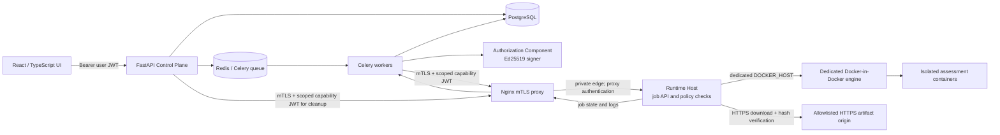

# SENTINEL-X Architecture

SENTINEL-X separates the user-facing Control Plane from the code-execution
Execution Plane. The Control Plane owns identity, tenant isolation, assessment
state, policy decisions, and orchestration. The Execution Plane runs assessment
artifacts in containers behind a private, authenticated interface.

## Service boundaries and job flow

The browser uses ordinary user access tokens for Control Plane APIs. The
Control Plane creates a durable authorization request when an assessment is
started, and the worker dispatches execution jobs to the Runtime Host. Build
and run are separate jobs with separate job IDs and narrowly scoped tokens.
The Runtime Host returns job state and a private advertised target address;
the Control Plane continues to own assessment state and tenant access.

PostgreSQL and Redis belong to the Control Plane. The Runtime Host has no
Control Plane database credentials and does not receive Ed25519 private signing
keys. It receives only the public token-verification key, the trusted client CA,
and a protected proxy credential. The Runtime Host has no published API port;
the Nginx proxy is its authenticated ingress. Its Docker daemon is a dedicated
`runtime_engine` service on the execution network, separate from the API and
worker containers.

## Security controls

### Service identity and authorization

- **mTLS at the Runtime Host boundary:** Nginx requires a certificate issued by
  the configured Control Plane client CA. Certificate revocation can be
  enforced with a configured CRL. The proxy authenticates to the Runtime Host
  using a protected shared credential; the Host API is not exposed directly.
- **Ed25519 capability tokens:** the Control Plane signs short-lived tokens
  bound to tenant, assessment, operation, worker identity, resources, and job
  ID. The Runtime Host verifies signatures using only the public key and checks
  that the token claims match the submitted job.
- **Atomic authorization consumption:** an authorization request transitions
  from pending to consumed with a conditional database update and row-count
  check. Dispatch happens only after that transaction commits, preventing two
  workers from both consuming the same request. Runtime mutation-token nonces
  are also claimed atomically to reject replay.
- **Tenant checks at every boundary:** Control Plane queries scope records to
  the owning tenant; Runtime Host job status, logs, and cancellation operations
  verify the authenticated token's tenant, assessment, operation, and job ID.

### Artifact delivery

The Runtime Host downloads artifacts itself, so no local Control Plane path is
assumed to exist on the execution VM. Artifact requests require HTTPS and an
explicit origin allowlist. The downloaded bytes must match the capability's
SHA-256 claim before extraction. Archive members are checked to resolve inside
the destination directory, preventing path traversal during extraction. The
Control Plane schema also rejects insecure schemes and private or reserved
literal IP destinations.

### Container isolation and resource limits

The Control Plane job schema accepts only the fixed execution posture and the
orchestrator supplies these values on every build and run job:

| Control | Enforced value |
| --- | --- |
| CPU limit | `1.0` CPU |
| Memory limit | `512m` |
| Process limit | `100` |
| Linux capabilities | Drop `ALL`; add none |
| New privileges | Disabled |
| Root filesystem | Read-only |
| Build network | `none` by default |
| Host mounts | None |

The Runtime Host constructs Docker arguments from its own policy. Caller job
fields cannot provide arbitrary Docker flags, mounts, privileges, or network
modes. Workloads run on the dedicated execution daemon, not on the Control
Plane host daemon.

## Configuration and operations

The root `.env.example` documents Control Plane, Runtime Host, mTLS, artifact
allowlist, database, Redis, and frontend settings. Private keys and certificates
must be provisioned outside source control and mounted only into the service
that needs them. Production requires `APP_ENV=production`, remote runtime mode,
valid mTLS material, a configured artifact origin allowlist, and a private
advertised Runtime Host address or hostname.

Schema changes are applied by a one-shot Alembic migration service before the
API and worker start. Operational procedures for Runtime Host deployment,
certificate rotation, and CRL updates are documented in
[`docs/operations/RUNTIME_HOST_DEPLOYMENT.md`](docs/operations/RUNTIME_HOST_DEPLOYMENT.md)
and [`docs/operations/RUNTIME_HOST_SECURITY.md`](docs/operations/RUNTIME_HOST_SECURITY.md).

## CI validation

GitHub Actions runs backend tests and a frontend TypeScript/build job on pushes
and pull requests to `main`. Docker-backed isolation tests and the physical
Runtime Host live-execution harness are excluded from the backend CI test step;
they require infrastructure outside a standard hosted runner test process.
