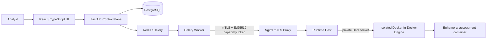

# SENTINEL-X

## AI-Powered Application Security & DevSecOps Platform

SENTINEL-X brings application security analysis, software supply-chain inspection, risk scoring, and human-reviewed AI remediation into one workflow. It combines a React security console with a Python control plane and a separately isolated execution plane.

## Architecture

The **Control Plane** uses FastAPI for authenticated API requests and Celery workers for assessment orchestration. It stores platform state in PostgreSQL and dispatches authorized execution jobs to the **Execution Plane**.

The **Execution Plane** runs in the Runtime Host with its own Docker-in-Docker engine. The control plane reaches the Runtime Host through an Nginx mTLS proxy; the Runtime Host is isolated on the proxy-facing edge and accesses its Docker engine through a private Unix socket. Scanned projects run in short-lived containers with a fixed security policy.



## Security Controls

- **Zero-Trust mTLS boundary:** Control-plane calls to the Runtime Host pass through a client-certificate-verifying Nginx proxy.
- **Ed25519 capability tokens:** Short-lived, scoped tokens bind runtime actions to the authorized tenant, assessment, operation, and job.
- **Atomic token consumption:** Authorization state is consumed atomically to prevent replay and time-of-check/time-of-use races.
- **SSRF protections:** Artifact delivery requires HTTPS, validates configured origins, rejects private and special-use addresses, verifies SHA-256, and extracts archives with path containment checks.
- **Constrained containers:** Runtime policy drops all Linux capabilities (`cap_drop: ALL`), enables `no-new-privileges`, uses a read-only root filesystem, and sets CPU and memory limits.
- **Isolated execution networking:** Runtime Host traffic to the control plane enters through the proxy boundary; assessment workloads use a restricted network policy.

## Technology Stack

- **Frontend:** React, TypeScript, Vite
- **Control Plane:** Python, FastAPI, Celery
- **Persistence and messaging:** PostgreSQL, SQLite for local/test stores, Redis
- **Execution:** Docker, Docker-in-Docker Runtime Host, Nginx mTLS proxy
- **Security analysis:** SAST, secret scanning, SBOM and dependency analysis, deterministic risk scoring, and optional AI-assisted remediation

## Getting Started

1. Clone the repository and enter its directory:

   ```bash
   git clone <repository-url>
   cd Sentinal-X
   ```

2. Create the local environment file and configure the required secrets, signing keys, certificates, database credentials, and runtime settings from `.env.example`:

   ```bash
   cp .env.example .env
   ```

3. Start the Compose stack:

   ```bash
   docker compose up -d
   ```

Use non-placeholder credentials and correctly provisioned certificates for shared or production environments. See [ARCHITECTURE.md](ARCHITECTURE.md) and [STAGE_3B_EXECUTION_GUIDE.md](STAGE_3B_EXECUTION_GUIDE.md) for design and execution details.

## Validation

Run component checks from their respective directories:

```bash
(cd backend && python -m pytest tests/ --ignore=tests/integration/test_live_execution.py)
(cd runtime_host && PYTHONPATH=.. python -m pytest tests/)
(cd frontend && npm run typecheck && npm run build)
```
