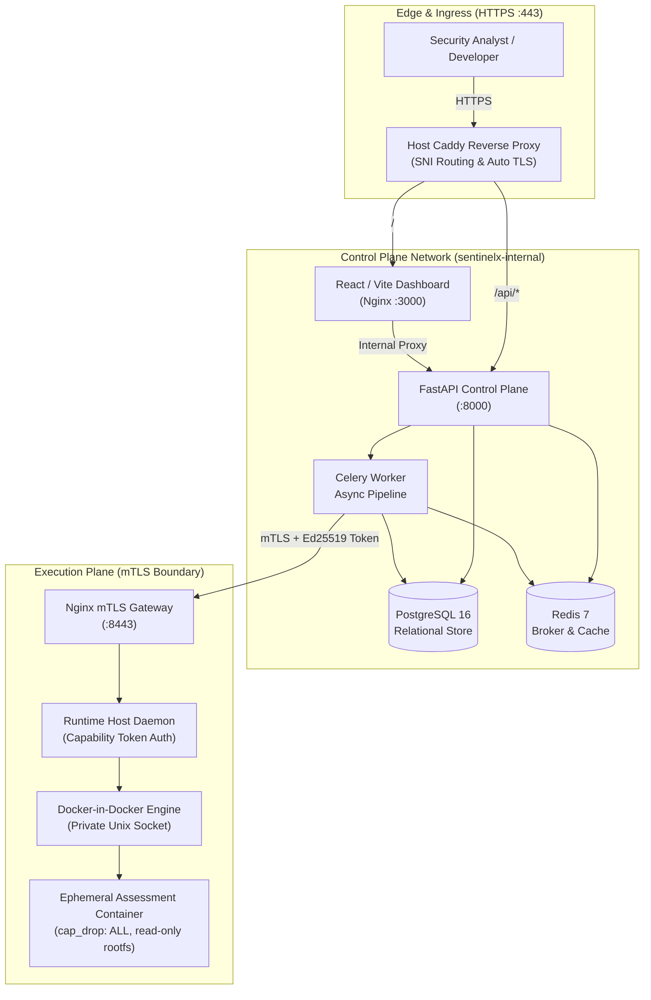

# SENTINEL-X

> **Enterprise-Grade Application Security & DevSecOps Microservices Platform**

[](https://github.com/PranavBShenoy/Sentinal-X/actions/workflows/deploy.yml)
[](https://github.com/PranavBShenoy/Sentinal-X)
[](https://github.com/astral-sh/ruff)
[](https://github.com/PyCQA/bandit)
[](LICENSE)

---

## 🌐 Live Production Deployment

Sentinel-X is deployed and operating live in production on AWS EC2, co-existing cleanly alongside existing workloads via SNI-isolated Caddy reverse-proxy routing with automatic Let's Encrypt TLS:

* **Production URL:** [https://sentinelx.54.79.97.73.nip.io](https://sentinelx.54.79.97.73.nip.io)
* **API Documentation (Swagger UI):** [https://sentinelx.54.79.97.73.nip.io/docs](https://sentinelx.54.79.97.73.nip.io/docs)
* **System Telemetry & Health Probe:** [https://sentinelx.54.79.97.73.nip.io/api/v1/health/telemetry](https://sentinelx.54.79.97.73.nip.io/api/v1/health/telemetry)

---

## 📌 Executive Overview

**Sentinel-X** is an end-to-end security microservices platform that orchestrates Static Application Security Testing (SAST), Secret Detection, Software Bill of Materials (SBOM) generation, Dependency & CVE Vulnerability Scanning, Dynamic Application Security Testing (DAST), and human-in-the-loop AI remediation into a unified workflow.

The system is architected around a strict separation of concerns between a secure **Control Plane** (API, DB, Worker, Scheduler) and an isolated **Execution Plane** (Docker-in-Docker sandboxes governed by mTLS and Ed25519 capability tokens), preventing untrusted repository code from compromising the host infrastructure.

---

## 🏗️ System Architecture



### Component Breakdown

| Service | Technology | Description |
| :--- | :--- | :--- |
| **Frontend** | React 18, TypeScript, Vite, Tailwind CSS, Lucide | Dark-mode security dashboard for project management, scan creation, findings exploration, and remediation PR review. |
| **Control API** | Python 3.11, FastAPI, Pydantic v2, SQLAlchemy | High-performance async REST API providing authentication, project/repository management, assessment pipelines, and telemetry. |
| **Worker Queue** | Celery 5.4, Redis 7 | Distributed job scheduler managing scanner task orchestration, artifact extraction, and correlation workflows. |
| **Database** | PostgreSQL 16, Alembic | ACID-compliant persistence for tenants, credentials, repositories, scan jobs, normalized findings, and audit logs. |
| **Runtime Gateway** | Nginx with mutual TLS (mTLS) | Validates client certificates (`client.crt`) from the worker before admitting control traffic to the Runtime Host. |
| **Runtime Host** | FastAPI Daemon, Ed25519 | Enforces cryptographic capability token verification, single-use nonce consumption, and job lifecycle timeouts. |
| **Runtime Engine** | Docker-in-Docker (DinD) | Ephemeral, isolated execution environment with strict cgroup resource constraints and network boundary controls. |

---

## 🔍 Core Security Scanning Capabilities

Sentinel-X integrates industry-standard security scanners into a correlated, normalized reporting engine:

| Capability | Engine / Tool | Description |
| :--- | :--- | :--- |
| **SAST** | [Semgrep](https://semgrep.dev/) | Semantic static code analysis detecting code injection, OWASP Top 10 vulnerabilities, and insecure patterns. |
| **Secret Scanning** | [Gitleaks](https://github.com/gitleaks/gitleaks) | High-entropy and regex-based scanning for API keys, access tokens, credentials, and certificates across Git history. |
| **SBOM Generation** | [Syft](https://github.com/anchore/syft) | Deep container and repository software bill of materials cataloging (CycloneDX and SPDX formats). |
| **Vulnerability Scanning** | [Grype](https://github.com/anchore/grype), [Trivy](https://github.com/aquasecurity/trivy), [OSV](https://osv.dev/) | Multi-engine CVE correlation across package manifests (npm, pip, maven, cargo, go) with CVSS v3.1 scoring. |
| **Active DAST** | [OWASP ZAP](https://www.zaproxy.org/) | Automated passive and active dynamic application security testing against deployed web endpoints. |
| **AI Remediation** | [OpenRouter](https://openrouter.ai/) / Claude / GPT-4 | Human-reviewed automated patch and PR generation addressing high-confidence vulnerabilities. |

---

## 🛡️ Enterprise Security Hardening

Sentinel-X enforces Defense-in-Depth across every layer:

1. **Private Repository Token Encryption:**
   - Personal Access Tokens (PATs) and deploy tokens for private GitHub, GitLab, and Bitbucket repositories are encrypted at rest using **Fernet AES-128-CBC** with HMAC authentication.
   - Plaintext credentials never appear in API responses (masked previews like `glpat-...3456` only).
   - In-memory clone injection redacts secrets from stderr, stdout, and error logs via strict regex filtering (`_sanitize_error`).

2. **Server-Side Request Forgery (SSRF) Guard:**
   - Strict URI scheme allowlisting (`https://`, `http://`).
   - Deep DNS resolution validation filtering RFC-1918 private subnets (`10.0.0.0/8`, `172.16.0.0/12`, `192.168.0.0/16`), loopback (`127.0.0.0/8`), link-local (`169.254.0.0/16`), and AWS metadata endpoints (`169.254.169.254`).

3. **Zero-Trust mTLS & Capability Tokens:**
   - Worker-to-Runtime communication requires bidirectional certificate validation.
   - Execution jobs require an **Ed25519-signed capability token** specifying exact tenant, assessment, operation, and expiration parameters.
   - Atomic token consumption prevents replay attacks and race conditions.

4. **Container Isolation & Sandboxing:**
   - Scanned code runs in non-root containers (`useradd -r sentinelx`).
   - Linux capabilities dropped completely (`cap_drop: [ALL]`).
   - Privilege escalation blocked (`no-new-privileges: true`).
   - Read-only root filesystem with memory-constrained `tmpfs` mounts.
   - Hardware limits: CPU quotas, memory ceilings (2GB max), and strict execution timeouts.

5. **Authentication & Password Security:**
   - Header-based JWT authentication (`Authorization: Bearer <token>`).
   - Passwords hashed with **PBKDF2-SHA256** (600,000 iterations, 32-byte salt) and validated via constant-time comparison (`secrets.compare_digest`).

---

## 🚀 Quick Start & Local Setup

### Prerequisites
* Docker Engine 24.0+ and Docker Compose v2.20+
* Git
* Make (optional)

### 1. Clone the Repository
```bash
git clone https://github.com/PranavBShenoy/Sentinal-X.git
cd Sentinal-X
```

### 2. Configure Environment Variables
```bash
cp .env.example .env
```
*(Optionally review `.env` to configure your `JWT_SECRET`, `ENCRYPTION_KEY`, and scanner API keys).*

### 3. Launch the Stack
```bash
docker compose up -d
```

### 4. Run Database Migrations
```bash
docker compose exec -T api python -m alembic upgrade head
```

### 5. Access the Platform
* **Web Dashboard:** [http://localhost:3000](http://localhost:3000)
* **API Documentation (OpenAPI/Swagger):** [http://localhost:8000/docs](http://localhost:8000/docs)
* **API Health Check:** [http://localhost:8000/api/v1/health](http://localhost:8000/api/v1/health)
* **Telemetry & Queue Monitoring:** [http://localhost:8000/api/v1/health/telemetry](http://localhost:8000/api/v1/health/telemetry)

---

## 🧪 Testing & Quality Assurance

Sentinel-X maintains a strict zero-regression quality standard:

```bash
# Run backend unit test suite (279 passing tests)
cd backend
PYTHONPATH=. python3 -m pytest tests/unit/ -v

# Run Python linter check (Ruff)
ruff check .

# Run AST security audit (Bandit)
bandit -r app/ -ll -ii

# Verify frontend build & typecheck
cd ../frontend
npm run typecheck
npm run build
```

---

## 🔄 CI/CD & Automated Deployment

Sentinel-X includes a production-ready GitHub Actions deployment pipeline in [`.github/workflows/deploy.yml`](.github/workflows/deploy.yml):

* **Trigger:** Automated on pushes to `main` branch.
* **Stage 1 (Test):** Runs Ruff, Bandit security analysis, Pytest unit tests, and Node.js 20 frontend builds in parallel.
* **Stage 2 (Deploy):** Securely deploys to the AWS EC2 instance over SSH, performs atomic Docker Compose rolling recreation, executes Alembic migrations, runs automated health checks, and reloads Caddy without downtime.

---

## 📄 License

This project is licensed under the MIT License — see the [LICENSE](LICENSE) file for details.
