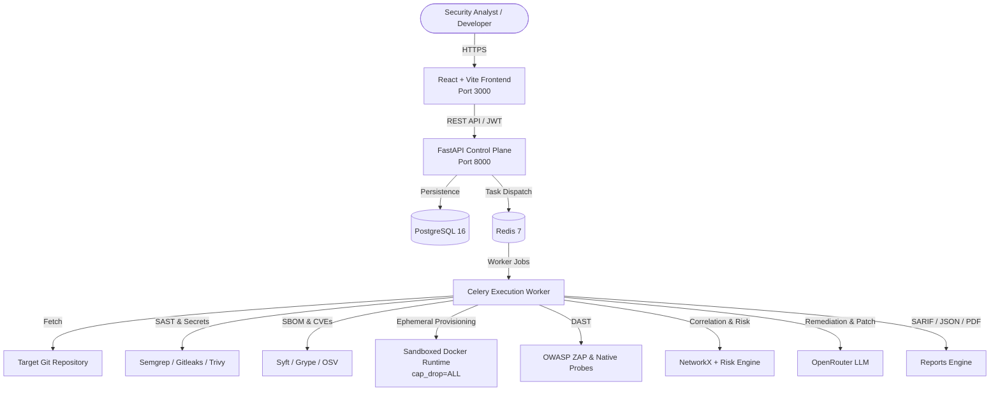

# SENTINEL-X

> **AI-Powered Application & Software Supply-Chain Security Assessment Platform**

SENTINEL-X is an enterprise-grade security assessment platform designed to bridge the gap between static application security testing (SAST), software supply-chain analysis (SBOM & SCA), isolated ephemeral runtime orchestration, active dynamic application security testing (DAST), and evidence-grounded AI remediation.

---

## Key Features

- **Multi-Engine Static & Secret Analysis**: Semgrep SAST, Gitleaks secret detection with automatic credential masking, and Trivy infrastructure/configuration audits.
- **Supply-Chain Visibility & Graph**: CycloneDX 1.5 SBOM generation with Syft, vulnerability intelligence with Anchore Grype and OSV.dev, and NetworkX directed graph analysis for transitive reachability.
- **SSRF Defense Architecture (SEC-01)**: Comprehensive IP and DNS verification engine with socket-level connection pinning (`PinnedSSRFNetworkBackend`), blocking loopback, link-local metadata (`169.254.169.254`), RFC 1918 subnets, alternative IP encodings, and DNS rebinding attacks.
- **Shared Atomic Rate Limiting (OPS-01)**: Distributed Redis-backed sliding-window rate limiter executed via Lua script, client IP spoofing protection with `TRUSTED_PROXIES`, and full RFC 6585 compliance.
- **Hardened Isolated Docker Runtime (INFRA-01)**: Ephemeral application provisioning with dropped capabilities (`cap_drop=['ALL']`), no-new-privileges, read-only root filesystems, non-root user execution (UID 10001 / node), memory/CPU caps, and active HTTP health probing.
- **Deterministic 0–10 Risk Engine**: Mathematical scoring factoring base CVSS, reachability, exposure context, and scanner confidence with clear rationale text.
- **Evidence-Grounded AI Remediation**: OpenRouter LLM integration with prompt injection defenses, Pydantic validation, and human-in-the-loop diff approval.
- **Enterprise Reporting**: OASIS SARIF 2.1.0, Machine JSON, CSV, and WeasyPrint PDF reports.
- **Modern Security Dashboard**: React 18, TypeScript, Vite, and Tailwind CSS dark-mode security console.

---

## System Architecture



---

## Technology Stack

| Layer | Technologies |
|---|---|
| **Frontend** | React 18, TypeScript, Vite, Tailwind CSS, Lucide Icons |
| **Backend API** | Python 3.11+, FastAPI, Pydantic v2, SQLAlchemy 2.0, Alembic |
| **Task Queue** | Celery, Redis |
| **Database** | PostgreSQL 16 (production), SQLite (unit/integration test suite) |
| **Security Engines** | Semgrep, Gitleaks, Anchore Syft, Anchore Grype, Trivy, OWASP ZAP |
| **Intelligence** | OSV.dev REST API, NVD, GitHub Security Advisories |
| **Orchestration** | Docker Engine SDK, Linux cgroups & namespaces |
| **Reporting** | WeasyPrint, OASIS SARIF v2.1.0 JSON Schema |

---

## Quickstart with Docker Compose

1. **Clone the repository**:
   ```bash
   git clone https://github.com/organization/sentinel-x.git
   cd sentinel-x
   ```

2. **Configure Environment Variables**:
   ```bash
   cp .env.example .env
   # Edit .env to configure JWT_SECRET_KEY, ENCRYPTION_KEY, and optional OPENROUTER_API_KEY
   ```

3. **Start the Platform**:
   ```bash
   docker compose up --build -d
   ```

4. **Access the Web Console**:
   - Frontend Dashboard: [http://localhost:3000](http://localhost:3000)
   - FastAPI Interactive Docs: [http://localhost:8000/docs](http://localhost:8000/docs)
   - API Health Check: [http://localhost:8000/health](http://localhost:8000/health)

---

## Local Development & Testing

### Backend Setup & Test Suite
```bash
# Navigate to backend
cd backend

# Install dependencies
pip install .
pip install pytest pytest-cov

# Run migrations
alembic upgrade head

# Run complete test suite (76 tests: 75 passed, 1 skipped)
PYTHONPATH=. python -m pytest tests/ -v
```

### Frontend Setup & Build
```bash
# Navigate to frontend
cd frontend

# Install dependencies
npm install

# Run local development server
npm run dev

# Run production build & TypeScript validation
npm run build
```

---

## Project Structure

```text
sentinel-x/
├── backend/
│   ├── app/
│   │   ├── analysis/          # Normalization, correlation, graph, risk engine
│   │   ├── api/               # FastAPI endpoints, auth dependencies, routers
│   │   ├── core/              # Config, security, logging, subprocess, redaction
│   │   ├── integrations/      # Semgrep, Gitleaks, Syft, Grype, Trivy, ZAP, OSV, OpenRouter
│   │   ├── models/            # SQLAlchemy 2.0 database entities
│   │   ├── reporting/         # PDF, SARIF, JSON, CSV generators
│   │   ├── runtime/           # Project detection, Docker orchestrator, cleaner
│   │   ├── schemas/           # Pydantic v2 validation models
│   │   ├── services/          # Repository fetch, pipeline orchestrator
│   │   └── workers/           # Celery application & task handlers
│   ├── migrations/            # Alembic schema migrations
│   └── tests/                 # Unit, integration, and end-to-end test suites
├── frontend/
│   ├── src/
│   │   ├── app/               # Main application routing and context
│   │   ├── components/        # Badges, meters, navbar, sidebar, layout
│   │   ├── features/          # Auth, dashboard, projects, assessments, findings, remediation, reports
│   │   ├── lib/               # Typed API client, utility functions
│   │   └── types/             # Full TypeScript interfaces matching backend models
├── infrastructure/
│   └── docker/                # Multi-stage Dockerfiles and Nginx reverse proxy configs
├── docs/                      # Architectural, threat model, and operational guides
├── tests/fixtures/            # Vulnerable test fixtures (SQLi, secrets, bad headers, deps)
├── docker-compose.yml         # Multi-service local orchestrator
├── LEARNING_GUIDE.md          # Comprehensive defense and interview master guide
└── SECURITY.md                # Security disclosure and hardening policy
```

---

## License

This project is licensed under the Apache 2.0 License.
