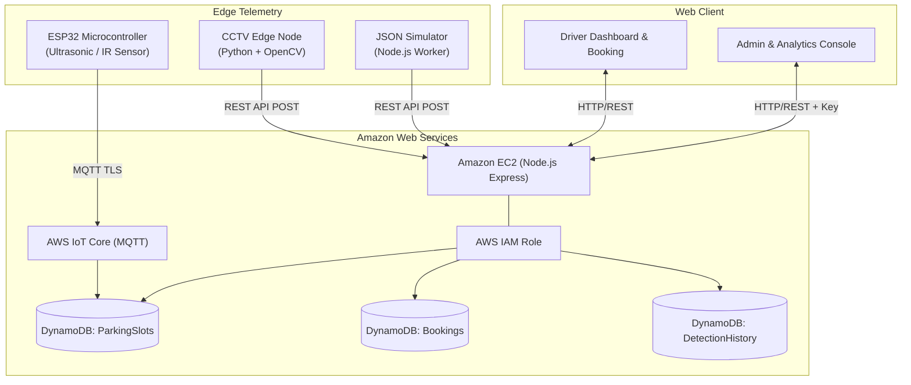

# Cloud-Based Smart Parking Management System

[](https://aws.amazon.com/dynamodb/)
[](https://nodejs.org/)
[](https://expressjs.com/)
[](https://opencv.org/)
[](https://www.espressif.com/)
[]()

A cloud-native smart parking platform that automatically detects parking slot occupancy using a multi-modal edge pipeline:
1. **IoT Sensor Telemetry:** ESP32 microcontrollers with ultrasonic/IR sensors communicating over MQTT to AWS IoT Core.
2. **CCTV Computer Vision:** Python and OpenCV analyzing video frames using adaptive thresholding and ROI pixel density metrics.
3. **JSON Simulation Engine:** Periodic automated vehicle turnover generator for rapid evaluation.

Occupancy data is processed and stored in **Amazon DynamoDB** with conditional transactions preventing double-booking, and surfaced via an enterprise dark navy responsive dashboard with **Chart.js** analytics.

---

## 🌟 Key Features

- **Live Multi-Zone Visualization:** Real-time parking facility map with color-coded bay status:
  - 🟢 **FREE:** Vacant and available for immediate booking.
  - 🔴 **OCCUPIED:** Vehicle physically detected by sensor or camera.
  - 🟡 **RESERVED:** Bay reserved by a driver; awaiting vehicle arrival.
  - ⚪ **UNKNOWN:** Bay sensor reading unverified.
- **Atomic Reservation Concurrency:** Employs DynamoDB conditional writes (`#status = 'FREE'`) to guarantee that concurrent booking requests cannot double-book the same bay.
- **Multi-Source Conflict Resolution:** Physical sensors reporting `FREE` on a `RESERVED` bay will not silently overwrite a user's reservation until the user cancels or the reservation expires.
- **Admin & Analytics Console:** Real-time facility KPI monitoring, bay creation/deletion, manual status overrides (`source: "ADMIN"`), and Chart.js occupancy distribution charts.
- **Zero-Credential Cloud Security:** Architecture utilizes AWS IAM Instance Profiles on EC2, eliminating hardcoded access keys in code or configuration.

---

## 🏗️ System Architecture



---

## 📁 Repository & Folder Structure

```
cloud-smart-parking-system/

├── frontend/
│   ├── index.html
│   ├── dashboard.html
│   ├── booking.html
│   ├── admin.html
│   │
│   ├── css/
│   │   ├── style.css
│   │   ├── dashboard.css
│   │   └── responsive.css
│   │
│   ├── js/
│   │   ├── api.js
│   │   ├── dashboard.js
│   │   ├── booking.js
│   │   └── admin.js
│   │
│   └── assets/
│       ├── images/
│       └── icons/
│
├── backend/
│   ├── server.js
│   ├── package.json
│   ├── .env.example
│   │
│   ├── config/
│   │   ├── dynamodb.js
│   │   └── aws.js
│   │
│   ├── routes/
│   │   ├── parkingRoutes.js
│   │   ├── bookingRoutes.js
│   │   ├── adminRoutes.js
│   │   └── detectionRoutes.js
│   │
│   ├── controllers/
│   │   ├── parkingController.js
│   │   ├── bookingController.js
│   │   ├── adminController.js
│   │   └── detectionController.js
│   │
│   ├── services/
│   │   ├── parkingService.js
│   │   ├── bookingService.js
│   │   └── detectionService.js
│   │
│   ├── middleware/
│   │   └── authMiddleware.js
│   │
│   └── models/
│       └── parkingModel.js
│
├── detection/
│   ├── sample-data/
│   │   └── parking-data.json
│   │
│   ├── simulator/
│   │   └── simulator.js
│   │
│   ├── sensor/
│   │   ├── README.md
│   │   ├── virtual_sensor.js
│   │   └── esp32-code/
│   │       └── esp32_parking_sensor.ino
│   │
│   └── cctv/
│       ├── detect.py
│       ├── slot_config.json
│       ├── requirements.txt
│       ├── sample-video/
│       │   ├── generate_synthetic_video.py
│       │   └── sample_parking.mp4
│       └── README.md
│
├── aws/
│   ├── architecture.md
│   ├── dynamodb-schema.md
│   ├── ec2-deployment.md
│   └── iot-core-setup.md
│
├── docs/
│   ├── project-overview.md
│   ├── screenshots/
│   └── project-report.md
│
├── .gitignore
└── README.md
```

### 🔒 Environment Configuration & Security

- **`.env.example`** is committed in the GitHub repository as a configuration template.
- **`.env`** is **strictly ignored** by `.gitignore` to prevent committing secrets or credentials.
- To configure your local environment, copy the template:
  ```bash
  cd backend
  cp .env.example .env     # On Linux/macOS
  copy .env.example .env   # On Windows
  ```


---

## 🚀 Quickstart Guide

### 1. Prerequisites
- [Node.js](https://nodejs.org/) (v18 or higher; v22 recommended)
- [Python](https://www.python.org/) (v3.10 or higher with OpenCV installed)

### 2. Install & Run the Backend
```bash
# Navigate to backend directory
cd backend

# Install dependencies
npm install

# Start development server
npm start
```
The server will start at **`http://localhost:5000`** with local DynamoDB persistence active by default.

### 3. Open the Web Application
Open your web browser and visit:
- **Landing Page:** `http://localhost:5000/`
- **Live Parking Grid:** `http://localhost:5000/dashboard.html`
- **Reserve a Slot:** `http://localhost:5000/booking.html`
- **Admin & Analytics:** `http://localhost:5000/admin.html` *(Default Admin Key: `admin-secret-key-smart-parking-2026`)*

### 4. Run the JSON Simulation Engine
In a separate terminal, start the periodic vehicle simulation:
```bash
# Run continuous stochastic simulation
node detection/simulator/simulator.js

# Or run a single cycle for verification
node detection/simulator/simulator.js --once
```
Watch the slots transition between FREE and OCCUPIED on the live dashboard in real time!

### 5. Run the OpenCV CCTV Computer Vision Node
Generate the synthetic parking surveillance video and run frame analysis:
```bash
# Step 1: Generate sample video
python detection/cctv/sample-video/generate_synthetic_video.py

# Step 2: Run vehicle detection
python detection/cctv/detect.py --frames=60

# Or with graphical OpenCV window
python detection/cctv/detect.py --show
```

### 6. Run the Virtual IoT Sensor Cluster
To simulate ESP32 ultrasonic sensors measuring vehicle distances:
```bash
# Run one reading cycle
node detection/sensor/virtual_sensor.js --once

# Or run continuous sensor stream
node detection/sensor/virtual_sensor.js
```

---

## 🧪 Running Automated Tests

Run the comprehensive integration test suite to verify health checks, slot queries, atomic bookings, race-condition rejection, cancellation, and admin authentication:
```bash
cd backend
npm test
```
**Test Results:** `15 passed, 0 failed` ✅

---

## 📡 REST API Reference

| Method | Endpoint | Description | Auth Required |
| :--- | :--- | :--- | :--- |
| `GET` | `/api/health` | Backend health, uptime & database mode | Public |
| `GET` | `/api/parking/slots` | Retrieve all registered parking bays | Public |
| `GET` | `/api/parking/availability` | Facility availability metrics & slot list | Public |
| `GET` | `/api/parking/slots/:id` | Get specific bay details | Public |
| `POST` | `/api/bookings` | Atomically reserve an available parking bay | User ID |
| `GET` | `/api/bookings` | Retrieve user bookings (optional `?userId=`) | User ID |
| `PUT` | `/api/bookings/:id/cancel` | Cancel booking & release bay back to FREE | User ID |
| `GET` | `/api/admin/dashboard` | Facility statistics & Chart.js telemetry | Admin Key |
| `POST` | `/api/admin/slots` | Register a new parking bay | Admin Key |
| `DELETE` | `/api/admin/slots/:id` | Remove a parking bay from the facility | Admin Key |
| `PUT` | `/api/admin/slots/:id/status` | Manual status override (`source: "ADMIN"`) | Admin Key |
| `POST` | `/api/detection/update` | Ingest detection reading (Single or Batch) | Node |
| `GET` | `/api/detection/history` | Audit trail of bay occupancy changes | Public |

---

## ☁️ AWS Cloud Configuration

To connect the application to live AWS infrastructure:
1. Update `backend/.env`:
   ```ini
   DB_MODE=aws
   AWS_REGION=us-east-1
   ```
2. Follow the detailed guides in the `aws/` directory:
   - [AWS Architecture & Data Flow](aws/architecture.md)
   - [Amazon DynamoDB Schema & GSIs](aws/dynamodb-schema.md)
   - [Amazon EC2 Ubuntu Production Deployment](aws/ec2-deployment.md)
   - [AWS IoT Core & ESP32 Setup](aws/iot-core-setup.md)

---

## 📄 Academic Project Details
- **Subject:** Cloud Computing (Mini Project)
- **Student Project:** Cloud-Based Smart Parking Management System
- **Technologies:** AWS EC2, AWS DynamoDB, AWS IoT Core, Node.js, Express, OpenCV, Python, ESP32, Chart.js.
