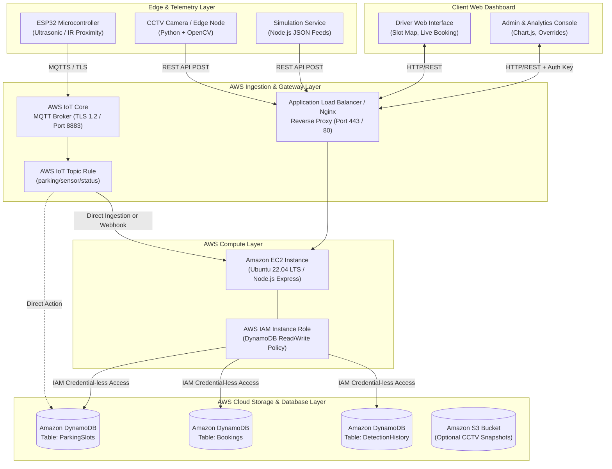

# Cloud-Based Smart Parking Management System
## AWS Cloud Architecture & Technical Specification

### 1. Architectural Overview

The Cloud-Based Smart Parking Management System is an enterprise-grade, multi-tier IoT and Computer Vision solution deployed on Amazon Web Services (AWS). It unifies physical vehicle detection across diverse edge telemetry sources (Ultrasonic IoT microcontrollers, CCTV video streams, and JSON simulation feeds) into a high-throughput, low-latency cloud database with real-time web visualization and reservation capabilities.



---

### 2. Edge & Ingestion Modalities

#### A. Edge Computer Vision (CCTV Footage)
- **Edge Component:** Python application executing OpenCV frame capture.
- **Processing:** Image pre-processing (Gaussian blur, adaptive thresholding, morphological closing) within bounding polygon coordinates assigned to each parking bay.
- **Protocol:** HTTP REST POST with TLS encryption to `/api/detection/update`.
- **Payload Contract:**
  ```json
  {
    "parkingArea": "Zone A - Ground Level",
    "source": "CCTV",
    "slots": [
      { "slotId": "A01", "status": "OCCUPIED", "confidence": 0.94 },
      { "slotId": "A02", "status": "FREE", "confidence": 0.98 }
    ]
  }
  ```

#### B. IoT Microcontroller Sensor Telemetry (ESP32)
- **Edge Component:** ESP-WROOM-32 with HC-SR04 ultrasonic distance sensors.
- **Processing:** Median filtering of ultrasonic echo pulses. If object distance $< 50\text{ cm}$, status is flagged `OCCUPIED`; otherwise `FREE`.
- **Protocol:** MQTT over TLS (Port 8883) authenticated via X.509 device certificates.
- **AWS Endpoint:** AWS IoT Core endpoint (`<id>-ats.iot.<region>.amazonaws.com`).
- **Topic:** `parking/sensor/status`.

#### C. JSON Simulation Engine
- **Component:** Node.js worker simulating stochastic parking arrival/departure cycles.
- **Purpose:** Continuous automated testing, load verification, and live evaluation when hardware sensors or live video cameras are not connected.

---

### 3. Compute & Application Layer (Amazon EC2)

1. **Host:** Amazon EC2 t3.micro / t3.small running Ubuntu 22.04 LTS.
2. **Process Supervisor:** PM2 runtime manager for zero-downtime clustering and auto-recovery.
3. **Web Server:** Nginx configured as a reverse proxy terminating HTTP/HTTPS and forwarding traffic to Node.js on port 5000.
4. **Security & Identity:**
   - **No hardcoded AWS credentials** exist in source code or configuration.
   - An **AWS IAM Role** (`SmartParkingEC2Role`) is attached to the EC2 instance profile, granting least-privilege policies to DynamoDB tables.
   - Administrative endpoints (`/api/admin/*`) require API Key header validation (`x-admin-key`).

---

### 4. Cloud Database Design (Amazon DynamoDB)

Amazon DynamoDB was selected for its single-digit millisecond latency, serverless scalability, and native support for conditional writes and multi-item transactions.

- **`ParkingSlots` Table:** Manages current state, source, confidence, and timestamps.
- **`Bookings` Table:** Tracks user reservations, assigned vehicle numbers, and reservation statuses.
- **`DetectionHistory` Table:** Immutable time-series audit trail recording every state transition.

#### Concurrency & Double-Booking Protection
To ensure two users cannot book the same slot at the same millisecond:
```javascript
Update: {
  TableName: 'ParkingSlots',
  Key: { slotId: 'A01' },
  UpdateExpression: 'SET #s = :reserved, #lu = :now',
  ConditionExpression: '#s = :free',
  ExpressionAttributeNames: { '#s': 'status', '#lu': 'lastUpdated' },
  ExpressionAttributeValues: { ':reserved': 'RESERVED', ':free': 'FREE', ':now': now }
}
```
If two requests race, DynamoDB atomically accepts the first and rejects the second with a `ConditionalCheckFailedException` / `TransactionCanceledException`.

---

### 5. Multi-Source Conflict Resolution Model

The platform distinguishes between **physical occupancy** (measured by sensors or cameras) and **administrative reservation** (created by a user booking):

| Current Status | Sensor/CCTV Detection | Resulting System Status | Reason / Handling |
| :--- | :--- | :--- | :--- |
| `FREE` | `OCCUPIED` | `OCCUPIED` | Vehicle arrived and parked. |
| `OCCUPIED` | `FREE` | `FREE` | Vehicle departed. |
| `RESERVED` | `OCCUPIED` | `OCCUPIED` | Reserved driver arrived and occupied slot. |
| `RESERVED` | `FREE` | `RESERVED` | **Reservation preserved!** Sensor detects space is physically empty awaiting arrival. |
| Any | Admin Override | Admin Value | Explicit administrator action (Source: `ADMIN`). |
