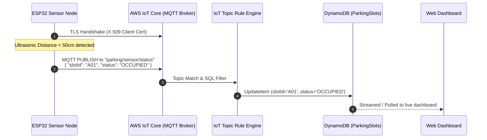

# AWS IoT Core Setup & Integration Guide
## Cloud-Based Smart Parking Management System

This document describes how to configure **AWS IoT Core** to securely receive telemetry from ESP32 edge microcontrollers equipped with ultrasonic or IR sensors, and forward parking occupancy states to Amazon DynamoDB.

---

### 1. Architectural Role of AWS IoT Core

AWS IoT Core acts as a managed MQTT message broker (supporting MQTT over TLS v1.2 on port 8883) capable of ingesting high-frequency telemetry from thousands of parking sensors with mutual X.509 certificate authentication.



---

### 2. Step 1: Create an IoT Thing in AWS IoT Core

1. Open the **AWS IoT Core Console**.
2. In the navigation menu, expand **Manage** > **All devices** > **Things**.
3. Choose **Create things** > **Create single thing**:
   - **Thing Name:** `SmartParkingSensorNode-01`
   - **Thing Type:** `ParkingBaySensor` (Optional)
   - **Device Shadow:** Unnamed (classic) shadow or No shadow.
4. Click **Next**.

---

### 3. Step 2: Generate Device Certificates & Keys

1. Under **Device certificate**, choose **Auto-generate a new certificate (recommended)**.
2. Click **Next**.
3. **Download Credentials Immediately:**
   - Device certificate (`<id>-certificate.pem.crt`)
   - Private key file (`<id>-private.pem.key`)
   - Public key file (`<id>-public.pem.key`)
   - Root CA certificate: Download **Amazon Root CA 1** (`AmazonRootCA1.pem`).
4. Click **Done**.

---

### 4. Step 3: Create & Attach IoT Policy

1. Go to **Security** > **Policies** > **Create Policy**.
2. **Policy Name:** `SmartParkingIoTPolicy`
3. Enter policy statements in JSON view:
   ```json
   {
     "Version": "2012-10-17",
     "Statement": [
       {
         "Effect": "Allow",
         "Action": "iot:Connect",
         "Resource": "arn:aws:iot:*:*:client/${iot:Connection.Thing.ThingName}"
       },
       {
         "Effect": "Allow",
         "Action": "iot:Publish",
         "Resource": [
           "arn:aws:iot:*:*:topic/parking/sensor/status",
           "arn:aws:iot:*:*:topic/parking/sensor/heartbeat"
         ]
       },
       {
         "Effect": "Allow",
         "Action": "iot:Subscribe",
         "Resource": "arn:aws:iot:*:*:topicfilter/parking/sensor/config"
       },
       {
         "Effect": "Allow",
         "Action": "iot:Receive",
         "Resource": "arn:aws:iot:*:*:topic/parking/sensor/config"
       }
     ]
   }
   ```
4. Attach `SmartParkingIoTPolicy` to the downloaded device certificate.
5. Attach the certificate to the Thing (`SmartParkingSensorNode-01`).

---

### 5. Step 4: Configure AWS IoT Core Routing Rule

Create an IoT Rule to forward incoming MQTT payloads directly to Amazon DynamoDB or backend webhook.

1. In the AWS IoT Console, navigate to **Message routing** > **Rules** > **Create rule**.
2. **Rule Name:** `ParkingSensorIngestionRule`
3. **SQL Statement:**
   ```sql
   SELECT 
     slotId, 
     status, 
     'IOT' AS source, 
     confidence, 
     timestamp() AS detectionTimestamp, 
     parse_time("yyyy-MM-dd'T'HH:mm:ss.SSS'Z'", timestamp()) AS lastUpdated
   FROM 'parking/sensor/status'
   ```
4. **Action:** Choose **DynamoDB (update table)** or **HTTP Destination / Lambda**:
   - **Table name:** `ParkingSlots`
   - **Hash key:** `slotId`
   - **Hash key value:** `${slotId}`
   - **Update expression:** `SET #s = :status, #src = :source, #lu = :lastUpdated, #conf = :confidence`
   - **IAM Role:** Create `IoTRuleToDynamoDBRole` with `dynamodb:UpdateItem` permissions.
5. Choose **Save**.

---

### 6. Step 5: Testing with the AWS MQTT Test Client

Before flashing hardware:
1. In AWS IoT Console, go to **Test** > **MQTT test client**.
2. In the **Subscribe to a topic** tab:
   - **Topic filter:** `parking/sensor/#`
   - Choose **Subscribe**.
3. In the **Publish to a topic** tab:
   - **Topic name:** `parking/sensor/status`
   - **Message payload:**
     ```json
     {
       "slotId": "A01",
       "status": "OCCUPIED",
       "confidence": 0.99,
       "distanceCm": 24.5
     }
     ```
   - Click **Publish**.
4. Observe the message arrive on the subscribed topic and automatically update the `ParkingSlots` DynamoDB table and web dashboard.
