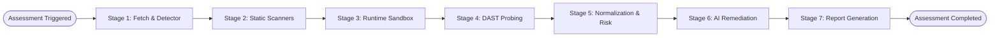

# SENTINEL-X — Assessment Pipeline Architecture

The Assessment Pipeline (`app.services.assessment_pipeline.AssessmentPipeline`) orchestrates static code analysis, software supply-chain scanning, runtime container sandboxing, dynamic web application vulnerability testing, finding correlation, and report compilation.

---

## Pipeline Execution Stages

### Stage 1: Repository Fetch & Framework Detection
- Allocates an isolated, ephemeral workspace under `settings.ASSESSMENT_WORKSPACE_BASE/<assessment_id>`.
- Validates git clone URLs and local filesystem paths against traversal and command injection attacks.
- Executes `ProjectDetector.analyze_directory`:
  - Detects project language (`python`, `javascript`, `typescript`, `go`, etc.).
  - Detects web frameworks (`fastapi`, `flask`, `django`, `express`, `nextjs`).
  - Identifies target entry points and extracted port numbers for dynamic probing.

### Stage 2: Static & Supply-Chain Analysis (Parallel Scanners)
- **Semgrep SAST**:
  - Executes bundled offline ruleset `rules/semgrep/default_rules.json` with zero external network access.
  - Flags dangerous SQL query construction, XSS reflections, and command injection patterns.
- **Gitleaks Secret Scanner**:
  - Scans full commit history and working tree using bundled rule configurations.
  - Detects leaked AWS, Stripe, GitHub, Slack, and private cryptographic keys.
- **Syft SBOM Extraction**:
  - Generates comprehensive CycloneDX 1.5 JSON SBOM.
  - Indexes all software components, exact package versions, and PURLs.
- **Grype Vulnerability Matcher**:
  - Matches the CycloneDX SBOM against cached local database `v6/vulnerability.db`.
  - Maps CVEs with CVSS scores, affected package versions, and fix versions.
- **Trivy Scanner**:
  - Scans application manifests and filesystem directories for published security advisories.
- **Google OSV-Scanner (v2.7.1)**:
  - Scans lockfiles (`requirements.txt`, `package-lock.json`) against local offline OSV database caches (`~/.cache/osv-scalibr/`).
  - Differentiates clean zero-vulnerability exits (`code 0`) from vulnerability matches (`code 1`), invalid manifests (`code 2`), and scanner execution failures.

### Stage 3: Runtime Sandboxing & Container Isolation
- Assesses host container environment via `RuntimeOrchestrator.is_docker_available()`.
- Generates a security-hardened Dockerfile creating unprivileged users (`USER sentinel:sentinel`).
- Enforces strict container isolation parameters:
  - `--cap-drop=ALL` (drops all Linux capabilities)
  - `--security-opt=no-new-privileges:true`
  - `--memory=512m` (memory hard cap)
  - `--cpus=1.0` (CPU quota limit)
  - Isolated bridge network with egress filtering.
- *Graceful Fallback*: When running inside restricted sandbox environments where Docker is unavailable, the orchestrator records `RuntimeStatus.BLOCKED` or `FAILED` without crashing static scans or report generation.

### Stage 4: Dynamic Application Security Testing (DAST)
- Evaluates target endpoints using `NativeDastScanner`.
- Enforces strict Anti-SSRF policies:
  - Rejects loopback addresses (`127.0.0.0/8`, `::1`), RFC1918 private subnets (`10.0.0.0/8`, `172.16.0.0/12`, `192.168.0.0/16`), link-local IPs (`169.254.0.0/16`), IPv4-mapped IPv6 addresses, and cloud provider metadata IPs (`169.254.169.254`, `metadata.google.internal`).
  - Disables automatic HTTP redirects that could pivot to private destinations.
- Probes for missing HTTP security headers (`Strict-Transport-Security`, `Content-Security-Policy`, `X-Frame-Options`, `X-Content-Type-Options`), server information leaks, and CORS misconfigurations.

### Stage 5: Normalization, Correlation & Risk Scoring
- Ingests disparate scanner outputs into a unified `Finding` model.
- Calculates deterministic SHA-256 finding fingerprints.
- Deduplicates identical CVEs reported across Grype, Trivy, and OSV.
- Calculates composite risk scores (0–100) using CVSS, EPSS exploitability, dependency directness, and secret sensitivity multipliers.

### Stage 6: AI-Powered Remediation
- Formats finding details and redacted code snippets into structured remediation prompts.
- Invokes OpenRouter models (`google/gemini-2.0-flash-001`, `anthropic/claude-3.5-sonnet`) to generate unified git diff patches with line replacement guidance.

### Stage 7: Compliance & Report Generation
- Exports comprehensive assessment artifacts:
  - **Machine JSON**: Full raw assessment telemetry and finding metadata.
  - **OASIS SARIF 2.1.0**: Industry-standard static analysis format for GitHub Code Scanning and IDE integration.
  - **Executive CSV**: Spreadsheet format for vulnerability triage and compliance audits.
  - **Executive PDF**: High-fidelity publication-quality PDF report rendered via WeasyPrint.
