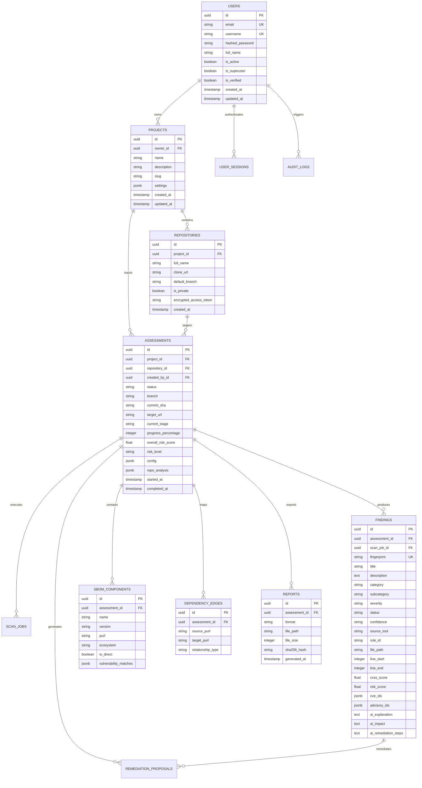

# SENTINEL-X — Database Design & Schema Architecture

SENTINEL-X uses a relational PostgreSQL schema (with full SQLite compatibility for fast hermetic local and CI testing) managed by Alembic migrations (`migrations/versions/1dca02b9811e_initial_schema.py`).

## 1. Entity-Relationship Overview

---

## 2. Multi-Tenant Isolation Guarantees
- **Strict Row-Level Authorization**: All API controllers verify that `Project.owner_id == current_user.id` or that the user has explicit project-level permissions.
- **Cascading Referential Integrity**: Deleting a project cascades cleanly across all child repositories, assessments, scan jobs, findings, SBOM components, and reports.
- **Tenant Boundary Tests**: Verified by `tests/integration/test_tenant_isolation_deep.py` and `tests/integration/test_projects_api.py`. A tenant can never query, mutate, or trigger assessments against another tenant's project or repository.

## 3. Cryptographic Storage & Masking
- **Fernet Encryption at Rest**: Encrypted database fields (such as repository OAuth tokens and deploy credentials) utilize standard AES-128-CBC with HMAC-SHA256 authenticated encryption (`app.core.security.encrypt_symmetric`).
- **Secret Redaction**: Any secret discovered by Gitleaks or raw scanner logs is permanently masked before persistence via `SecretMasker` and `mask_secret` regex algorithms.
