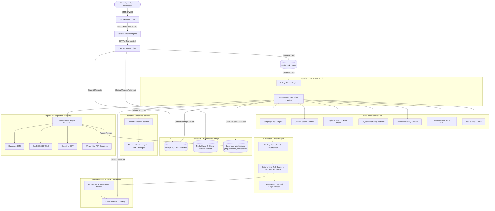

# SENTINEL-X — Data Flow Architecture

This document specifies the end-to-end data lifecycle, component boundaries, and security controls across SENTINEL-X.

---

## 1. Authentication & Session Flow
1. **User Registration / Login**: User sends credentials to `/api/v1/auth/login` or `/api/v1/auth/register`.
2. **Password Verification**: Passwords are hashed using Passlib `bcrypt` (12 rounds) with timing-safe evaluation.
3. **Token Issuance**: Returns standard JWT Access Token (30 min expiration) and cryptographically random Refresh Token (7 days expiration).
4. **Tenant Isolation**: Every project, repository, assessment, and finding query filters strictly on `owner_id == current_user.id` or user association.

## 2. Assessment Pipeline Execution Flow
1. **Repository Fetching**: Clones the remote or local repository into an ephemeral workspace directory (`/tmp/sentinelx_workspaces/<uuid>`).
2. **Language & Framework Detection**: Inspects manifest files (`requirements.txt`, `package.json`, `go.mod`, etc.) to dynamically parameterize scanners.
3. **Static Security Scans (SAST, Secrets, SBOM, Dependency Scanners)**:
   - **Semgrep**: Runs offline bundled security rules (`rules/semgrep/default_rules.json`) targeting OWASP Top 10 vulnerabilities (SQLi, XSS, SSRF).
   - **Gitleaks**: Discovers high-entropy leaked secrets and API keys, strictly masking secret content in logs and reports.
   - **Syft**: Generates an authoritative CycloneDX JSON Software Bill of Materials (SBOM).
   - **Grype**: Evaluates the generated Syft SBOM and filesystem against its cached offline vulnerability database (`v6/vulnerability.db`).
   - **Trivy**: Scans filesystems and manifests for package CVEs and misconfigurations.
   - **OSV-Scanner**: Evaluates dependency lockfiles against Google's open vulnerability database (PyPI, NPM, Go, crates.io).
4. **Runtime Sandboxing & Dynamic Testing (DAST)**:
   - Checks host container environment for Docker daemon capabilities.
   - When Docker is available, builds non-root ephemeral containers with `--cap-drop=ALL`, `--security-opt=no-new-privileges`, `--memory=512m`, and `--cpus=1.0`.
   - Executes non-destructive HTTP/DAST security checks against exposed application routes with anti-SSRF protections.
5. **Correlation, Deduplication & Risk Scoring**:
   - Maps heterogeneous scanner findings into a unified `Finding` model.
   - Calculates deterministic SHA-256 finding fingerprints across category, component, rule ID, and file path.
   - Merges identical CVE detections across Grype, Trivy, and OSV into a single deduplicated finding.
   - Computes weighted risk scores (0–100) accounting for CVSS, EPSS exploitability, direct vs. transitive dependency depth, and secret exposure severity.
6. **AI-Powered Remediation Hub**:
   - Feeds contextual finding data and sanitized code snippets into OpenRouter AI models (`google/gemini-2.0-flash-001`, `anthropic/claude-3.5-sonnet`).
   - Generates unified git diff patches with precise line replacement instructions.
7. **Report Compilation & Secure Downloads**:
   - Compiles machine-readable JSON, CI/CD-compatible OASIS SARIF 2.1.0, tabular CSV, and executive PDF reports.
   - Serves reports through `/api/v1/reports/{id}/download` with authenticated Bearer headers or time-limited signed URL query parameters.
