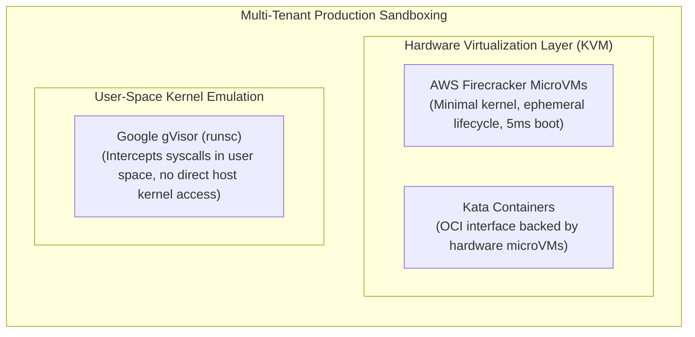

# SENTINEL-X — Docker & Runtime Sandboxing Architecture

This operational guide details the container sandboxing architecture, security parameters, host prerequisites, environmental boundary handling, and the security boundary analysis for dynamic application execution in SENTINEL-X.

---

## 1. Security Architecture & Threat Model

When executing target application source code for dynamic analysis, port probing, or dependency installation, SENTINEL-X treats repository code as untrusted and potentially adversarial. The runtime isolation engine (`app.runtime.docker.orchestrator.RuntimeOrchestrator`) enforces multi-layered defense-in-depth:

```mermaid
flowchart TD
    Host["Host Operating System / Host Kernel"]
    DockerDaemon["Docker Daemon (dockerd)"]
    
    subgraph ContainerSandbox ["Ephemeral Isolated Target Container"]
        NonRoot["Non-Root User (UID 10001 appuser / node)"]
        NoCaps["Cap Drop: ALL (No Linux Kernel Capabilities)"]
        NoNewPriv["No-New-Privileges: true (SUID/SGID Disabled)"]
        ResourceCaps["cgroups: 512MB RAM, 1.0 CPU, 100 PIDs"]
        ReadOnlyRoot["Read-Only Root Filesystem + 64MB noexec tmpfs"]
        InternalNet["Dedicated Bridge Network (--internal, No Egress)"]
        LoopbackOnly["Loopback Port Forwarding (127.0.0.1:port)"]
    end

    Host --> DockerDaemon
    DockerDaemon --> ContainerSandbox
    ContainerSandbox -.x|"Blocked Outbound / Egress"| Internet["Public Internet / LAN / Cloud Metadata"]
```

---

## 2. Nine-Point Security Isolation Matrix

SENTINEL-X validates runtime security across nine critical isolation dimensions:

| # | Isolation Dimension | Enforcement Mechanism | Implementation Location | Verified Behavior |
|---|---------------------|------------------------|-------------------------|-------------------|
| **1** | **Non-Root Execution** | `USER 10001:10001` (`appuser`) for Python; `USER node` for Node.js | `app/runtime/docker/orchestrator.py` (`_generate_dockerfile`) | Container process runs with non-zero UID/GID; root execution is rejected. |
| **2** | **Dropped Linux Capabilities** | `--cap-drop=ALL` | `app/runtime/docker/orchestrator.py` | All kernel capabilities (`CAP_SYS_ADMIN`, `CAP_NET_RAW`, `CAP_NET_ADMIN`, etc.) are dropped. |
| **3** | **No-New-Privileges** | `--security-opt=no-new-privileges:true` | `app/runtime/docker/orchestrator.py` | Prevents setuid/setgid binaries and child processes from escalating privileges. |
| **4** | **Resource Quotas (cgroups)** | `--memory=512m`, `--cpus=1.0`, `--pids-limit=100` | `app/runtime/docker/orchestrator.py` | Prevents RAM exhaustion, CPU starvation, and fork bomb attacks. |
| **5** | **Filesystem Restrictions** | `--read-only`, `--tmpfs=/tmp:rw,noexec,nosuid,size=64m` | `app/runtime/docker/orchestrator.py`, `app/runtime/cleanup/workspace_cleaner.py` | Container filesystem is immutable; temporary files cannot execute binary payloads; workspace cleaner purges expired data. |
| **6** | **Network Isolation & Egress Prevention** | Dedicated network per container created with `--internal` | `app/runtime/docker/orchestrator.py` | Docker iptables rules drop all forwarding to WAN and non-local LAN subnets; no external outbound connectivity. |
| **7** | **Host & Metadata Access Prevention** | Zero host mounts (`-v`/`--volume` absent); socket unmounted; loopback-only bind (`-p=127.0.0.1:port`) | `app/runtime/docker/orchestrator.py` | Host filesystem and Docker daemon socket are inaccessible; cloud metadata (`169.254.169.254`) unreachable via internal network. |
| **8** | **Timeout, Cancellation & Cleanup** | Forced container and network cleanup via `docker rm -f`, `docker network rm`, `docker rmi` | `app/runtime/docker/orchestrator.py` | Deterministic teardown on assessment completion, failure, timeout, or manual cancellation. |
| **9** | **Failure Stage Resilience** | Handlers for build failure, startup failure, and health probe timeout | `app/runtime/docker/orchestrator.py` | Failures transition state to `FAILED` or `HEALTH_CHECK_FAILED` with resource reclamation. |

---

## 3. Docker Network Security & Boundary Analysis

### Dedicated Internal Network Architecture
To isolate each target container, `RuntimeOrchestrator` generates a deterministic network identifier `sentinelx-net-{assessment_id}` and provisions it via:
```bash
docker network create --internal sentinelx-net-{assessment_id}
```
The `--internal` flag modifies Docker's default bridge routing:
1. **Disables External Gateway Routing**: Docker omits the default MASQUERADE iptables rules for the bridge interface.
2. **Drops Forwarding**: In the `FORWARD` filter chain, all outgoing packets from the bridge subnet to external physical interfaces are dropped (`DOCKER-ISOLATION-STAGE-1` / `DOCKER-FORWARD`).
3. **No Default Bridge Fallback**: In `_start_container`, `net_res = run_command(["docker", "network", "create", ...])` is validated before launching the container. If network creation fails, container startup immediately aborts; the container is never launched on the default bridge network.

### Unintended Host Service Exposure Risk on Internal Bridges
While `--internal` completely eliminates forwarding to external IP addresses (the `FORWARD` chain), security architects must recognize an important nuance of Linux network filtering:
- **Bridge Gateway IP in Host `INPUT` Chain**: The host interface for the bridge is assigned a local IP (e.g., `172.18.0.1`). Packets sent by a container to this gateway IP traverse the host kernel's `INPUT` chain, not the `FORWARD` chain.
- **Risk**: Any host daemon listening on `0.0.0.0` (wildcard) is accessible to containers on that bridge unless host firewall rules explicitly filter traffic from `br-+` interfaces.
- **SENTINEL-X Mitigations**:
  1. Internal platform dependencies (PostgreSQL, Redis) are configured to bind exclusively to `127.0.0.1` or unix domain sockets (`/tmp/redis.sock`), never `0.0.0.0`.
  2. `--cap-drop=ALL` inside the container prevents raw socket creation, network spoofing, and interface sniffing.
  3. Production hardening recommendation: Add `iptables -I INPUT -i br-+ -p tcp -m multiport --dports 22,5432,6379 -j DROP` on dedicated scanner hosts.

### Port Binding Security & Analysis
- **Why Published Ports are Required**: SENTINEL-X dynamic scanners (HTTP health probes, DAST scanners, and dependency explorers) must communicate with the target application to analyze endpoint behaviors, headers, and vulnerabilities.
- **Loopback Enforcement**: Dynamic ports are bound exclusively to the host loopback interface:
  ```bash
  -p=127.0.0.1:{host_port}:{app_port}
  ```
  The orchestrator strictly rejects wildcard (`0.0.0.0`) or unmapped port flags, ensuring the target application cannot be probed by external machines on the local LAN or WAN.
- **Ordered Teardown**: Upon assessment completion, cancellation, or failure, resources are torn down in strict sequence:
  1. `docker rm -f {container_name}` (terminates process and releases port binding)
  2. `docker network rm {network_name}` (removes bridge and iptables chains)
  3. `docker rmi {image_tag}` (reclaims disk space)

---

## 4. Deployment Topology Assessment

| Deployment Topology | Architecture | Network Isolation Behavior | Operational Caveats |
| :--- | :--- | :--- | :--- |
| **1. Standalone Host / VM (Native Docker)** | SENTINEL-X worker runs on host VM with dockerd. | Verified. Each assessment gets dedicated `--internal` network. Cross-assessment communication is blocked. | Host services on `0.0.0.0` must be protected in the `INPUT` chain. |
| **2. Docker Compose (DooD / Docker-outside-of-Docker)** | Worker container mounts `/var/run/docker.sock` to spawn sibling containers. | Target container is on `sentinelx-net-{id}`, completely isolated from Docker Compose network (`sentinelx-internal`). | Worker must communicate with target via host loopback port mapping or dedicated bridge proxy. |
| **3. Kubernetes / Multi-Tenant Cloud** | Worker runs in Kubernetes Pod. | Docker CLI orchestration is not recommended; native Kubernetes `NetworkPolicy` (egress deny `0.0.0.0/0`) should be used. | Target applications should execute in ephemeral pods with hardware microVM runtimes (Kata Containers). |

---

## 5. Architectural Security Boundary Analysis: Containers vs. MicroVMs

### Is Docker Container Hardening Alone a Complete Security Boundary?

> [!WARNING]
> **Definitive Finding**: Docker container hardening alone is **NOT** a sufficient security boundary for running untrusted, hostile, or multi-tenant code submitted by arbitrary public users.

### Technical Analysis: Kernel Attack Surface

1. **Shared Kernel Model**:
   Containers share the host operating system kernel (`/boot/vmlinuz`, memory subsystems, network stacks, system call interface). Capabilities (`cap-drop`), seccomp, and namespaces (PID, IPC, UTS, Mount, Net) restrict user-space behavior, but the kernel remains directly addressable via hundreds of system calls.

2. **Privilege Escalation & Escape Vectors**:
   A malicious target application can leverage known kernel vulnerability classes to escape container boundaries:
   - **Kernel Subsystem Vulnerabilities**: Exploits in `io_uring`, eBPF (`bpf`), netfilter/nftables, or socket layers can achieve ring-0 execution on the host kernel.
   - **Race Conditions & Memory Corruption**: Exploits such as Dirty Pipe (CVE-2022-0847) or Dirty Cow (CVE-2016-5195) allow writing to read-only host pages across namespace boundaries.
   - **Filesystem & Driver Bugs**: Exploits in `overlayfs`, VFS, or storage driver ioctls can bypass mount namespace restrictions.

### Production Recommendations for Untrusted Code Sandboxing

For executing arbitrary untrusted code in a multi-tenant production environment, SENTINEL-X recommends:



1. **Disposable MicroVMs (AWS Firecracker / Cloud Hypervisor)**:
   - Provide genuine hardware-assisted virtualization (Intel VT-x / AMD-V via `/dev/kvm`).
   - Each assessment executes inside an isolated guest kernel with dedicated memory space.
   - A kernel panic or privilege escalation in the guest kernel does not compromise the host system.
2. **Kata Containers**:
   - Implements standard OCI runtime interfaces while backing every container with a lightweight VM.
3. **Google gVisor (`runsc`)**:
   - Intercepts all system calls in user space (`Sentry`), implementing Linux kernel abstractions without giving untrusted applications direct access to host kernel syscall dispatch tables.

---

## 6. Docker Socket Privilege Boundary Risk & Migration Path

### 6.1 The Risk: Worker Controls the Host Docker Daemon

In the Docker Compose topology, the SENTINEL-X worker container mounts the host Docker socket:

```yaml
volumes:
  - /var/run/docker.sock:/var/run/docker.sock:ro
```

This gives the worker process full authority over `dockerd` on the host. Because the worker executes user-supplied repository code (SAST/DAST/scanners) and accepts untrusted assessment input, a compromise of the worker is a direct host compromise:

- **Container escape**: `docker run --privileged`, volume mounts of `/` from the host, or `docker exec` into arbitrary containers.
- **Host filesystem access**: `docker run -v /:/host ...` reads/writes any host file.
- **Credential theft**: Docker daemon access can read secrets bound to other containers or the host environment.
- **Denial of service**: Stop/restart arbitrary containers, prune images/networks, exhaust host resources.

This is **not** mitigated by target-container hardening (`cap_drop`, `no-new-privileges`, read-only rootfs, `--internal` network), because those controls apply to the *target* containers the worker spawns, not to the worker itself, which talks directly to `dockerd` over the socket.

### 6.2 Current Status: NOT MITIGATED

> [!WARNING]
> **Definitive Finding**: The docker.sock privilege boundary is **NOT** resolved in the current architecture. The worker continues to require the socket mount to build and run ephemeral target containers. Removing the mount would break runtime execution.

The risk is accepted only insofar as the worker host is treated as a dedicated, hardened, single-tenant scanner host with no other production workloads.

### 6.3 Migration Paths (in order of isolation strength)

| Option | Mechanism | Isolation Gain | Effort | Breaks Execution? |
|--------|-----------|----------------|--------|-------------------|
| **A. Docker socket proxy** (defense-in-depth) | Deploy `docker-socket-proxy` (Teonite) sidecar on the worker host; mount only the proxy socket into the worker; whitelist `containers/*`, `build`, `network/*`, `images/*` read operations. | Worker can no longer `exec`, mount arbitrary host volumes, or run privileged containers. | Low/Medium | No (worker reconfigured to proxy socket) |
| **B. Separate runtime host** | Worker and target runtime run on different hosts. Worker submits build/run jobs to a dedicated runtime service over a restricted API (e.g., a small FastAPI service wrapping the Docker SDK). | Worker process never touches `dockerd`; compromise of worker does not directly compromise the host Docker daemon. | Medium/High | Yes (requires runtime service + worker re-architecture) |
| **C. Hardware microVM runtime** | Replace Docker execution with Kata Containers, AWS Firecracker, or gVisor (`runsc`) on a dedicated runtime host. | Guest kernel / syscall interception prevents container escape from reaching the host kernel. | High | Yes (runtime orchestrator re-architecture) |

### 6.4 Recommended Production Sequence

1. **Immediate**: Isolate the worker host — no other production services, strict host firewall, non-root dockerd (rootless) where possible.
2. **Short term**: Introduce a Docker socket proxy as a whitelisting layer between the worker and `dockerd` (Option A). This preserves existing execution while removing the most dangerous socket operations.
3. **Medium term**: Move execution to a separate runtime host or microVM-backed backend (Options B/C) before enabling multi-tenant or public-user assessment submission.

Do not mark this control as resolved until the worker no longer holds an unmediated host Docker socket mount.

