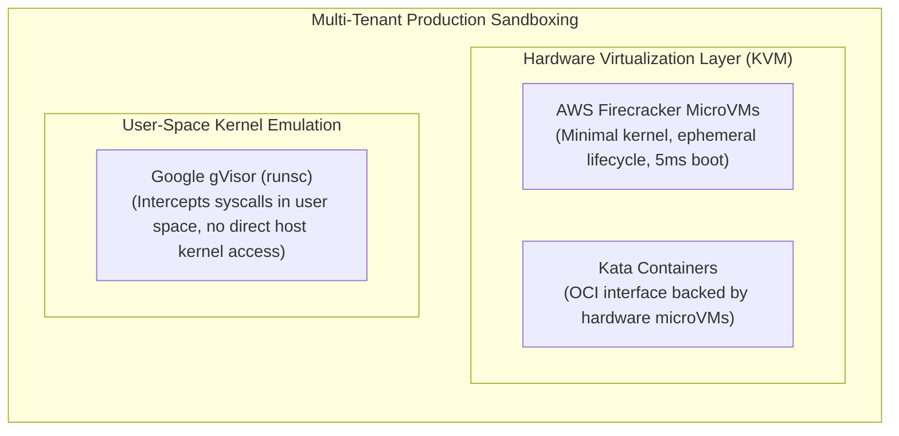

# SENTINEL-X — Docker & Runtime Sandboxing Architecture

This operational guide details the container sandboxing architecture, security parameters, host prerequisites, environmental boundary handling, and the security boundary analysis for dynamic application execution in SENTINEL-X.

---

## 1. Security Architecture & Threat Model

When executing target application source code for dynamic analysis, port probing, or dependency installation, SENTINEL-X treats repository code as untrusted and potentially adversarial. The runtime isolation engine (`app.runtime.docker.orchestrator.RuntimeOrchestrator`) enforces multi-layered defense-in-depth:

```mermaid
flowchart TD
    Host["Host Operating System / Host Kernel"]
    DockerDaemon["Docker Daemon (dockerd)"]
    
    subgraph ContainerSandbox ["Ephemeral Isolated Target Container"]
        NonRoot["Non-Root User (UID 10001 appuser / node)"]
        NoCaps["Cap Drop: ALL (No Linux Kernel Capabilities)"]
        NoNewPriv["No-New-Privileges: true (SUID/SGID Disabled)"]
        ResourceCaps["cgroups: 512MB RAM, 1.0 CPU, 100 PIDs"]
        ReadOnlyRoot["Read-Only Root Filesystem + 64MB noexec tmpfs"]
        InternalNet["Dedicated Bridge Network (--internal, No Egress)"]
    end

    Host --> DockerDaemon
    DockerDaemon --> ContainerSandbox
    ContainerSandbox -.x|"Blocked Outbound / Egress"| Internet["Public Internet / LAN / Cloud Metadata"]
```

---

## 2. Nine-Point Security Isolation Matrix

SENTINEL-X validates runtime security across nine critical isolation dimensions:

| # | Isolation Dimension | Enforcement Mechanism | Implementation Location | Verified Behavior |
|---|---------------------|------------------------|-------------------------|-------------------|
| **1** | **Non-Root Execution** | `USER 10001:10001` (`appuser`) for Python; `USER node` for Node.js | `app/runtime/dockerfile_generator.py` | Container process runs with non-zero UID/GID; root execution is rejected. |
| **2** | **Dropped Linux Capabilities** | `--cap-drop=ALL` | `app/runtime/docker/orchestrator.py` | All kernel capabilities (`CAP_SYS_ADMIN`, `CAP_NET_RAW`, `CAP_NET_ADMIN`, etc.) are dropped. |
| **3** | **No-New-Privileges** | `--security-opt=no-new-privileges:true` | `app/runtime/docker/orchestrator.py` | Prevents setuid/setgid binaries and child processes from escalating privileges. |
| **4** | **Resource Quotas (cgroups)** | `--memory=512m`, `--cpus=1.0`, `--pids-limit=100` | `app/runtime/docker/orchestrator.py` | Prevents RAM exhaustion, CPU starvation, and fork bomb attacks. |
| **5** | **Filesystem Restrictions** | `--read-only`, `--tmpfs=/tmp:rw,noexec,nosuid,size=64m` | `app/runtime/docker/orchestrator.py` | Container filesystem is immutable; temporary files cannot execute binary payloads. |
| **6** | **Network Isolation & Egress Prevention** | Dedicated network per container created with `--internal` | `app/runtime/docker/orchestrator.py` | Docker iptables rules drop all forwarding to WAN and non-local LAN subnets; no external outbound connectivity. |
| **7** | **Host & Metadata Access Prevention** | Zero host mounts (`-v`/`--volume` absent); socket unmounted; loopback-only bind (`-p=127.0.0.1:port`) | `app/runtime/docker/orchestrator.py` | Host filesystem and Docker daemon socket are inaccessible; cloud metadata (`169.254.169.254`) unreachable via internal network. |
| **8** | **Timeout, Cancellation & Cleanup** | Forced container and network cleanup via `docker rm -f`, `docker network rm`, `docker rmi` | `app/runtime/docker/orchestrator.py`, `app/runtime/cleanup/workspace_cleaner.py` | Deterministic teardown on assessment completion, failure, timeout, or manual cancellation. |
| **9** | **Failure Stage Resilience** | Handlers for build failure, startup failure, and health probe timeout | `app/runtime/docker/orchestrator.py` | Failures transition state to `FAILED` or `HEALTH_CHECK_FAILED` with resource reclamation. |

---

## 3. Host Environment Diagnostic & Status Classification

### Host Verification
When assessing runtime isolation on the current environment:
- **Docker Socket**: `/var/run/docker.sock` exists on the host.
- **Socket Permissions**: `srw-rw---- 1 root docker`.
- **Executing User**: User `pranav` (UID 1000) is not a member of the host `docker` group (GID 963).
- **Sudo Policy**: Passwordless `sudo` is not permitted in this execution environment.

### Status Classification: `INFRA-01: BLOCKED`
Because the user does not have read/write access to `/var/run/docker.sock`:
- **Code Hardening & Isolation Constraints**: **VERIFIED** via unit and integration tests (`backend/tests/integration/test_docker_runtime_isolation.py`).
- **Live Container Execution on Host**: **BLOCKED** (`INFRA-01: BLOCKED: Cannot connect to Docker daemon: permission denied on /var/run/docker.sock`).
- **System Resilience**: Static scanners (Semgrep, Gitleaks, Syft, Grype, Trivy, OSV) and assessment workflows run cleanly without crashing or hanging when Docker is unavailable.

---

## 4. Architectural Security Boundary Analysis: Containers vs. MicroVMs

### Is Docker Container Hardening Alone a Complete Security Boundary?

> [!WARNING]
> **Definitive Finding**: Docker container hardening alone is **NOT** a sufficient security boundary for running untrusted, hostile, or multi-tenant code submitted by arbitrary public users.

### Technical Analysis: Kernel Attack Surface

1. **Shared Kernel Model**:
   Containers share the host operating system kernel (`/boot/vmlinuz`, memory subsystems, network stacks, system call interface). Capabilities (`cap-drop`), seccomp, and namespaces (PID, IPC, UTS, Mount, Net) restrict user-space behavior, but the kernel remains directly addressable via hundreds of system calls.

2. **Privilege Escalation & Escape Vectors**:
   A malicious target application can leverage known kernel vulnerability classes to escape container boundaries:
   - **Kernel Subsystem Vulnerabilities**: Exploits in `io_uring`, eBPF (`bpf`), netfilter/nftables, or socket layers can achieve ring-0 execution on the host kernel.
   - **Race Conditions & Memory Corruption**: Exploits such as Dirty Pipe (CVE-2022-0847) or Dirty Cow (CVE-2016-5195) allow writing to read-only host pages across namespace boundaries.
   - **Filesystem & Driver Bugs**: Exploits in `overlayfs`, VFS, or storage driver ioctls can bypass mount namespace restrictions.

### Production Recommendations for Untrusted Code Sandboxing

For executing arbitrary untrusted code in a multi-tenant production environment, SENTINEL-X recommends:



1. **Disposable MicroVMs (AWS Firecracker / Cloud Hypervisor)**:
   - Provide genuine hardware-assisted virtualization (Intel VT-x / AMD-V via `/dev/kvm`).
   - Each assessment executes inside an isolated guest kernel with dedicated memory space.
   - A kernel panic or privilege escalation in the guest kernel does not compromise the host system.
2. **Kata Containers**:
   - Implements standard OCI runtime interfaces while backing every container with a lightweight VM.
3. **Google gVisor (`runsc`)**:
   - Intercepts all system calls in user space (`Sentry`), implementing Linux kernel abstractions without giving untrusted applications direct access to host kernel syscall dispatch tables.
