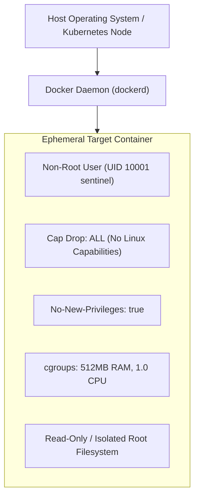

# SENTINEL-X — Docker & Runtime Sandboxing Architecture

This operational guide details the container sandboxing architecture, security parameters, host prerequisites, and environmental boundary handling in SENTINEL-X.

---

## 1. Security Architecture & Threat Model

When executing target application source code for dynamic analysis or dependency installation, SENTINEL-X treats repository code as untrusted and potentially adversarial. The runtime isolation engine (`app.runtime.orchestrator.RuntimeOrchestrator`) enforces multi-layered defense-in-depth:



### Mandatory Security Controls
1. **Non-Root Execution**:
   - The generated Dockerfile (`app.runtime.dockerfile_generator.DockerfileGenerator`) creates a dedicated group and user:
     ```dockerfile
     RUN groupadd -g 10001 sentinel && useradd -u 10001 -g sentinel -s /bin/sh sentinel
     USER sentinel:sentinel
     ```
2. **Capability Dropping**:
   - Every container run command includes `--cap-drop=ALL` to prevent privilege escalation, raw socket manipulation, kernel module loading, and system tracing.
3. **Privilege Boundary**:
   - `--security-opt=no-new-privileges:true` disables SUID/SGID binary execution.
4. **Resource Constraints (cgroups)**:
   - Hard limits prevent denial-of-service or fork-bombs:
     - Memory: `--memory=512m --memory-swap=512m`
     - CPU: `--cpus=1.0`
     - PIDs: `--pids-limit=100`
5. **Egress Network Filtering**:
   - Network connectivity is restricted to prevent lateral movement and C2 outbound callbacks.

---

## 2. Environment Verification & Reproduction

### Standard Production Environment (Docker Host)
On a host machine or Kubernetes node with Docker installed and the daemon running:
```bash
# 1. Verify Docker availability
docker info

# 2. Build worker and API images
docker compose build

# 3. Start complete platform
docker compose up -d

# 4. Verify running health status
curl -s http://127.0.0.1:8000/api/v1/health
```

### Restricted Container Sandboxes (No Host Docker Access)
When SENTINEL-X runs inside an existing locked-down container sandbox (e.g. cloud IDEs, unprivileged CI agents, or nested environments without Docker-in-Docker permissions):
1. `RuntimeOrchestrator.is_docker_available()` checks for the presence of the Docker CLI and a responsive Docker daemon socket (`/var/run/docker.sock`).
2. If the daemon is unreachable or returns an error (such as `permission denied` or `The "no new privileges" flag is set`), the orchestrator records:
   - `assessment.runtime_status = RuntimeStatus.FAILED` (or `BLOCKED`)
   - Logs an audit entry: `Runtime isolation skipped: Docker daemon unreachable in this host environment`
3. **Zero Cascade Failure**: The static scanning pipeline (Semgrep, Gitleaks, Syft, Grype, Trivy, OSV), finding correlation, risk scoring, remediation engine, and reporting pipeline continue executing without interruption.
