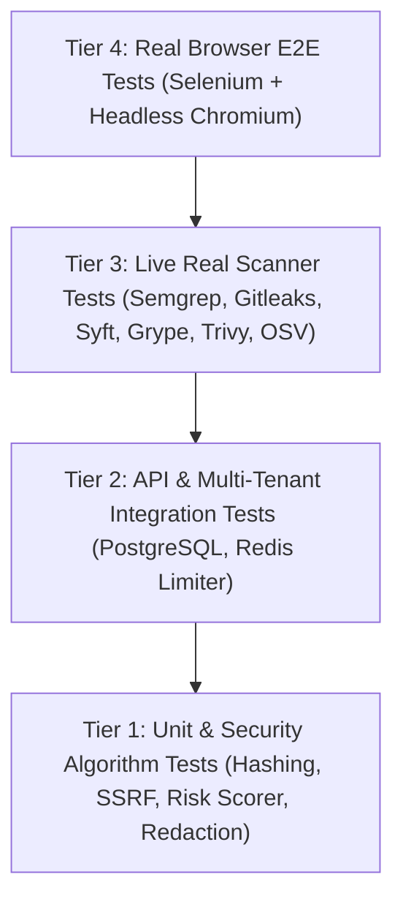

# SENTINEL-X — Comprehensive Test Strategy

SENTINEL-X employs a rigorous, multi-tiered test pyramid to guarantee security, correctness, and operational resilience across all application layers.

---

## 1. Testing Tiers & Scope

### Tier 1: Unit & Security Algorithm Tests (`backend/tests/unit/`)
- **Password & Token Security** (`test_security.py`):
  - Passlib bcrypt verification, JWT access/refresh token generation, cryptographic expiration, invalid signature rejection.
  - Secret redactor & pattern-based token masking (`test_secret_masking`, `test_secret_redactor`).
- **Anti-SSRF Verification** (`test_ssrf_protection.py`):
  - Validates rejection of IPv4 loopback (`127.0.0.1`), IPv6 loopback (`::1`), link-local/cloud metadata (`169.254.169.254`, `metadata.google.internal`), RFC1918 private ranges (`10.0.0.0/8`, `172.16.0.0/12`, `192.168.0.0/16`), IPv4-mapped IPv6, and encoded IP representations (`0x7f.0.0.1`, `2130706433`).
  - Verifies fail-closed behavior on DNS resolution failure and redirects.
- **Risk Engine & Normalization** (`test_risk_engine.py`, `test_normalization.py`):
  - Deterministic SHA-256 finding fingerprinting.
  - Multi-factor risk formula weighting CVSS, EPSS exploitability, direct vs. transitive dependency depth, and secret exposure severity.
- **Project Detection** (`test_detector.py`):
  - Manifest analysis across Python (FastAPI/Flask/Django) and Node.js ecosystems.

### Tier 2: Integration & Multi-Tenant Tests (`backend/tests/integration/`)
- **Multi-Tenant Isolation** (`test_tenant_isolation_deep.py`, `test_projects_api.py`):
  - Exhaustively tests cross-user CRUD isolation for projects, repositories, assessments, findings, SBOM graphs, remediation proposals, and reports.
- **Distributed Rate Limiter** (`test_redis_rate_limiter.py`):
  - Verifies sliding-window counter consistency across multiple worker nodes.
  - Tests client IP spoofing defense via reverse-proxy header validation (`X-Forwarded-For`).
  - Verifies standard HTTP 429 response codes with `Retry-After`, `X-RateLimit-Limit`, and `X-RateLimit-Remaining` headers.
- **Docker Isolation & Sandboxing** (`test_docker_runtime_isolation.py`):
  - Validates non-root user generation and security flags (`--cap-drop=ALL`, `--security-opt=no-new-privileges`).

### Tier 3: Live Scanner Regression Tests (`backend/tests/integration/test_live_scanners.py`)
- Executes **real binaries** against controlled vulnerable fixtures (`tests/fixtures/`):
  - **Semgrep**: Live detection of SQL injection (`tests/fixtures/vuln_sqli/main.py`) using bundled offline ruleset.
  - **Gitleaks**: Live detection of high-entropy secrets (`tests/fixtures/secret_leak/`) with masking.
  - **Syft & Grype**: Live CycloneDX SBOM generation and CVE matching against cached vulnerability database (`v6/vulnerability.db`).
  - **OSV-Scanner**: Dependency vulnerability scanning against local OSV database caches (`~/.cache/osv-scalibr/`).
  - **Trivy**: Live dependency and container vulnerability detection.
  - **Native DAST**: Live HTTP security header probing against local test servers.
  - **Deduplication**: Cross-scanner CVE deduplication merging identical findings from Grype, Trivy, and OSV into a single record.

### Tier 4: Real Browser End-to-End Tests (`backend/tests/e2e/test_browser_e2e.py`)
- Employs **headless Chromium** via Selenium WebDriver to validate the full user lifecycle:
  1. User Registration (`/register`) and JWT storage.
  2. User Login (`/login`) and session validation.
  3. Dashboard Telemetry Display (`/`).
  4. Project Creation with Local Vulnerability Fixture (`/projects`).
  5. Security Assessment Configuration & Pipeline Execution (`/assessments/new`).
  6. Live Progress Tracking and Pipeline Stage Transition.
  7. Findings Explorer (`/findings`) with search, severity filtering, and modal inspection.
  8. Interactive Dependency Relationship & Attack Graph (`/assessments/{id}/graph`).
  9. Automated Remediation Hub (`/remediation`).
  10. Multi-Format Report Generation & Authenticated Download (`/reports`).
